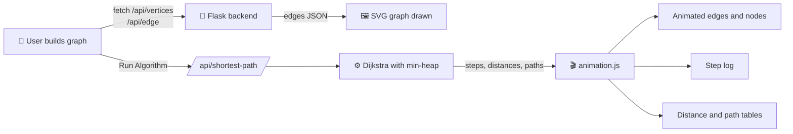

<div align="center">

# 🗺️ Dijkstra Algorithm Visualizer

**Watch the shortest-path algorithm think, one step at a time.**

An interactive web app that animates Dijkstra's algorithm on graphs you build yourself, with live distance tables, shortest-path output, and a step-by-step log.


[✨ Features](#-features) •
[🚀 Quick Start](#-quick-start) •
[🎮 How to Use](#-how-to-use) •
[🧠 How It Works](#-how-it-works) •
[👥 Team](#-team)

</div>

---

## 🖼️ Preview

<div align="center">

/DSA%20U3/preview.png)

</div>

---

## ✨ Features

| | Feature | Description |
|---|---|---|
| 🎨 | **Interactive graph builder** | Set the vertex count (1–26), then add edges with custom weights |
| ↔️ | **Directed & undirected edges** | Toggle the *Directed* checkbox to draw arrows on edges |
| ▶️ | **Animated execution** | Edges "draw" themselves and vertices turn green as they're visited |
| 📋 | **Live Step Log** | Every step shows the visited vertex and each distance update (`∞ → 4`) |
| 📊 | **Distance table** | Distances and Visited / Unvisited status update in real time |
| 🛣️ | **Shortest path table** | Full path to every vertex, e.g. `A -> C -> B -> D` |
| 🎲 | **10 sample graphs** | One click loads a random sample (never the same one twice in a row) |
| 🧹 | **Reset & Clear** | Reset the run, or wipe the whole graph and start over |
| 🛡️ | **Input validation** | Rejects negative weights, self-loops, invalid names, and too many vertices |
| 🚫 | **Unreachable vertices** | Handled gracefully and shown as `∞` / `No path` |

---

## 🚀 Quick Start

<details open>
<summary><b>1️⃣ Clone the repository</b></summary>

```bash
git clone https://github.com/<your-username>/<your-repo>.git
cd <your-repo>
```
</details>

<details open>
<summary><b>2️⃣ Install dependencies</b></summary>

```bash
# (optional) create a virtual environment
python -m venv venv
source venv/bin/activate        # macOS / Linux
venv\Scripts\activate           # Windows

pip install flask
```
</details>

<details open>
<summary><b>3️⃣ Run the app</b></summary>

```bash
python main.py
```

Then open **http://127.0.0.1:5000** in your browser. 🎉
</details>

---

## 🎮 How to Use

<details>
<summary><b>🔹 Build your own graph</b></summary>

1. Type the number of vertices (e.g. `5`) in **Enter Vertices** and press **Enter**.
2. In **Add Edge**, fill in `From`, `To` and `Weight` (e.g. `A`, `B`, `4`).
3. Tick **Directed** if you want a one-way edge.
4. Click **+ Add Edge**. Repeat until your graph is ready.
5. Enter a **Source Vertex** and click **▶ Run Algorithm**.

</details>

<details>
<summary><b>🔹 Try a sample graph</b></summary>

1. Click **✣ Sample Graph**. A random preset graph is built for you.
2. The source vertex is filled in automatically.
3. Click **▶ Run Algorithm** and watch it go.

</details>

<details>
<summary><b>🔹 Run it again</b></summary>

Click **⟳ Reset** to clear the animation and results, then run again from any source vertex. Use **▤ Clear Graph** to start completely fresh.

</details>

---

## 🧠 How It Works



<details>
<summary><b>📐 Algorithm summary</b></summary>

1. Set the source distance to `0` and every other vertex to `∞`.
2. Push `(0, source)` onto a **min-heap** (`heapq`).
3. Pop the closest unvisited vertex and mark it visited.
4. **Relax** each neighbour: if `current + weight < known distance`, update the distance and parent.
5. Repeat until the heap is empty, then rebuild paths from the `parents` map.

**Time complexity:** `O((V + E) log V)`

</details>

<details>
<summary><b>🔌 API endpoints</b></summary>

| Method | Endpoint | Purpose |
|:---:|---|---|
| `GET` | `/` | Main visualizer page |
| `GET` | `/about` | About Us page |
| `POST` | `/api/vertices` | Set the vertex limit (1–26) and reset the graph |
| `POST` | `/api/edge` | Add a directed or undirected weighted edge |
| `POST` | `/api/shortest-path` | Run Dijkstra and return steps, distances and paths |
| `POST` | `/api/clear` | Clear the graph from the server |

**Example request**

```json
POST /api/edge
{ "source": "A", "destination": "B", "weight": 4, "directed": false }
```

**Example response from `/api/shortest-path`**

```json
{
  "source": "A",
  "distances": { "A": 0, "B": 3, "C": 2 },
  "paths": { "B": { "distance": 3, "path": ["A", "C", "B"], "display": "A -> C -> B" } },
  "steps": [ { "current": "A", "distance": 0, "updates": [ { "vertex": "B", "old": null, "new": 4 } ] } ]
}
```

</details>

---

## 📁 Project Structure

```text
📦 dijkstra-visualizer
 ┣ 📜 main.py                # Flask server + Dijkstra implementation
 ┣ 📂 Frontend               # Jinja templates
 ┃ ┣ 📜 index.html           # Main visualizer page
 ┃ ┗ 📜 about_us.html        # About Us page (Bootstrap)
 ┗ 📂 Static                 # Static assets
   ┣ 📜 script.js            # Graph UI, validation, sample graphs, API calls
   ┣ 📜 animation.js         # Run animation, step log, result tables
   ┣ 📜 style.css            # Main page styles
   ┗ 📜 about_us.css         # About page styles
```

---

## 🛠️ Tech Stack

| Layer | Technology |
|---|---|
| **Backend** | Python, Flask, `heapq` |
| **Frontend** | HTML5, CSS3, Vanilla JavaScript, SVG |
| **UI (About page)** | Bootstrap 5.3 |

---

## 👥 Team

### Team Members & Their Contribution

<table>
  <tr>
    <td align="center" valign="top" width="33%">
      <h3>Subir Gain</h3>
      <b>🎨 GUI, Animation<br/>& About Us Page</b><br/><br/>
      <div align="left">
        Responsible for creating the complete GUI, including all the buttons and their animations. Also handled the graph visualization and graph animation, and built every frontend function, such as how the vertices and edges change and animate while the algorithm is running, and clearing the graph. Developed the About Us page using Bootstrap.
      </div>
    </td>
    <td align="center" valign="top" width="33%">
      <h3>T. Bharath</h3>
      <b>🧮 Dijkstra Implementation<br/>& Step Log</b><br/><br/>
      <div align="left">
        Responsible for implementing the complete Dijkstra's Algorithm in the backend. Worked on calculating shortest distances, finding the shortest paths, updating distances, and handling different graph structures and unreachable vertices to ensure correct results. Also handled the Step Log function to display the algorithm's execution steps.
      </div>
    </td>
    <td align="center" valign="top" width="33%">
      <h3>Priyanka Roy</h3>
      <b>🔗 Backend to Frontend Integration<br/>& Sample Graphs</b><br/><br/>
      <div align="left">
        Responsible for connecting the frontend with the backend, ensuring user inputs are processed correctly and results are displayed in real time. Worked on integrating GUI features with the backend, handling requests and responses, and ensuring proper connection. Also developed the Sample Graph feature.
      </div>
    </td>
  </tr>
</table>

---

## 🔮 Future Ideas

- [ ] Pause / step-forward / speed controls for the animation
- [ ] Drag-and-drop vertex positioning
- [ ] Compare with Bellman-Ford and A*
- [ ] Export the graph as an image or JSON
- [ ] Per-user sessions (the graph is currently stored globally on the server)

---

## 🤝 Contributing

Contributions are welcome!

```bash
git checkout -b feature/amazing-idea
git commit -m "Add amazing idea"
git push origin feature/amazing-idea
```

Then open a Pull Request. 🚀

---

<div align="center">

⭐ **If this project helped you learn Dijkstra's algorithm, give it a star!** ⭐

© 2026 Dijkstra Visualizer Team. All rights reserved.

</div>

